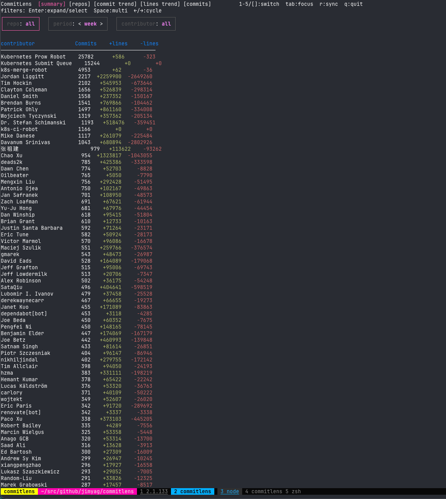
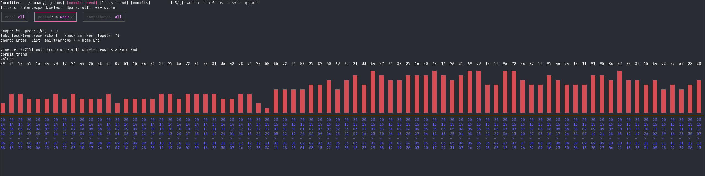
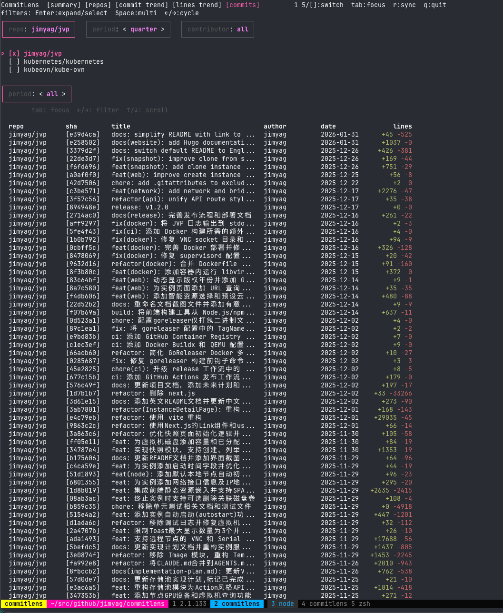
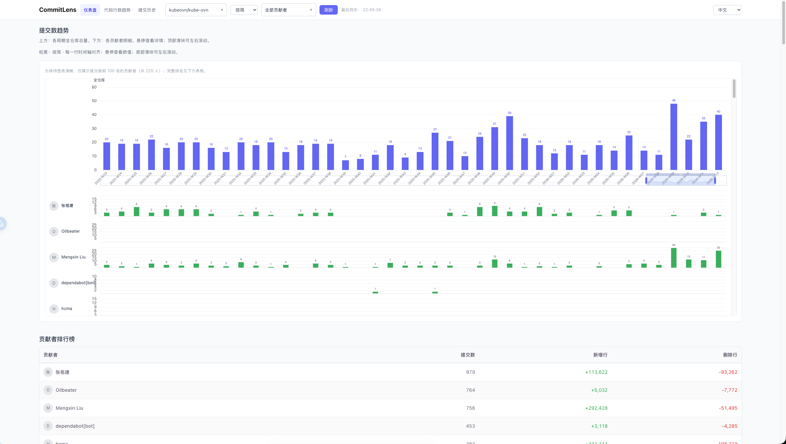
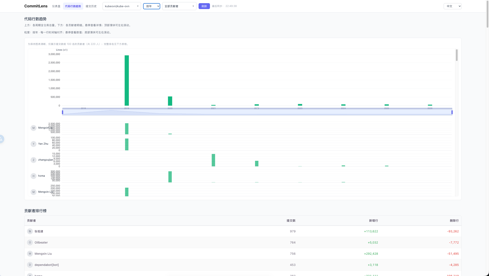
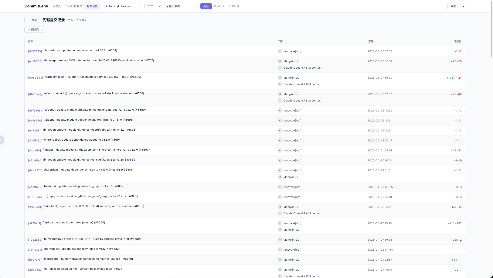

# CommitLens

一个通用的 Git 贡献分析工具，深度追踪每位贡献者的**提交数**、**新增行数**与**删除行数**。它拥有强大的本地 Git 分析引擎、极速的终端 TUI 界面，以及嵌入在单一二进制文件中的现代化 Web UI。



## 核心功能

- **通用 Git 引擎**：同时支持本地文件系统仓库和远程 GitHub 仓库 URL（通过自动 Bare Clone）。分析历史记录无需担心 GitHub API 速率限制。
- **高级过滤查询**：支持仓库和贡献者的**多选**过滤。可按周、月、季度或年进行下钻分析。
- **贡献趋势分析**：
  - **提交量趋势**：直观展示历史活跃度。
  - **代码行数趋势**：通过堆叠柱状图追踪代码产出与重构力度（新增/删除行）。
  - **周期比较**：同时对比上一周期和最多三个历史同期。
- **GitHub 组织贡献图**：按组织和年份展示 Commit、PR、Issue、Code review 与贡献日历，并可下载为 PNG。
- **交互式 TUI**：由 `bubbletea` 驱动的极速、全键盘操作终端界面。
- **现代化 Web UI**：基于 React + ECharts 的响应式界面，支持搜索、滚动和高密度数据展示。
- **多作者识别**：基于 `Co-authored-by` 准确计算所有贡献者的功劳。
- **单二进制部署**：前端资源编译进二进制文件，一个文件即开即用。
- **生产级 CI/CD**：集成 GitHub Actions 与 GoReleaser，实现多平台自动构建发布。

## 界面截图

### 终端 TUI
| 提交趋势 | 提交历史 |
| :---: | :---: |
|  |  |

### Web 界面
| 仪表盘 (提交) | 行数趋势 | 提交历史 |
| :---: | :---: | :---: |
|  |  |  |

## 快速开始

### 安装
从 [Releases](https://github.com/jimyag/commitlens/releases) 下载最新版本的二进制文件。

### 配置
创建一个 `config.yaml`：
```yaml
discoveryRoots:
  - ~/src/github.com/kubernetes  # 自动扫描此目录下所有 git 仓库
repositories:
  - owner: example-org           # Web：发现组织仓库，再选择需要同步的仓库
  - owner: example-org
    repo: example-repo           # 精确远程仓库，默认参与同步
userMap:
  "Jim Yang": ["jimyag", "yang.jim@example.com"] # 将多个别名映射到同一个自然人
reporting:
  timezone: Local                # 也可以使用 Asia/Taipei 等 IANA 时区
```

只配置 `owner` 时，该条目作为 Web 仓库发现源。CommitLens 会列出当前
GitHub token 有权访问的组织仓库，但不会自动同步整个组织。在 Web 的仓库
下拉框中勾选仓库后点击“刷新”即可同步。原有的 `owner` + `repo` 精确配置和
本地目录发现仓库仍保持默认同步行为。

GitHub 组织贡献图使用 GraphQL API。查看私有贡献时，请确保 token 具有
`read:user` 权限；贡献为 0 的年份会自动省略。

Web 和 TUI 的提交趋势、代码行趋势都会展示周期比较图。周粒度会比较前几个月
相同月内周次，月和季度会比较往年同期；当前尚未结束的周期按相同进度比较。

### 使用
```bash
# 启动终端 TUI
./commitlens --config config.yaml

# 启动 Web UI (默认端口: 8080)
./commitlens --web --config config.yaml
```

## 快捷键 (TUI)
- `1-5`: 切换标签页 (汇总, 仓库, 提交趋势, 行数趋势, 提交列表)。
- `[` / `]`: 轮换标签页。
- `Tab`: 在过滤器与内容区之间切换焦点。
- `Enter`: 展开过滤器下拉框 / 查看提交详情。
- `Space`: 在下拉列表中进行多选。
- `Shift + ←/→`: 左右横移缩放趋势图。
- `R`: 强制同步/刷新数据。
- `Q`: 退出。

鼠标操作：

- 点击标签页、过滤器、下拉选项、仓库行和提交行。
- 使用滚轮浏览下拉列表和提交列表，或横向移动趋势图。
- 点击趋势图中的周期可打开对应的提交列表。

## 开发

### 依赖
- Go 1.22+
- [nvm](https://github.com/nvm-sh/nvm)
- [Task](https://taskfile.dev/)

### 从源码编译
```bash
task build
```

## 许可证
MIT
